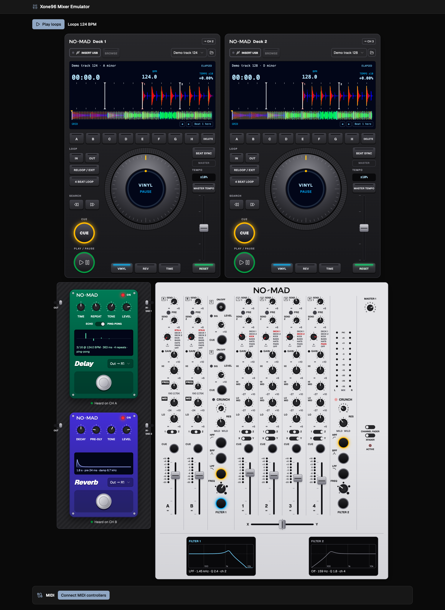
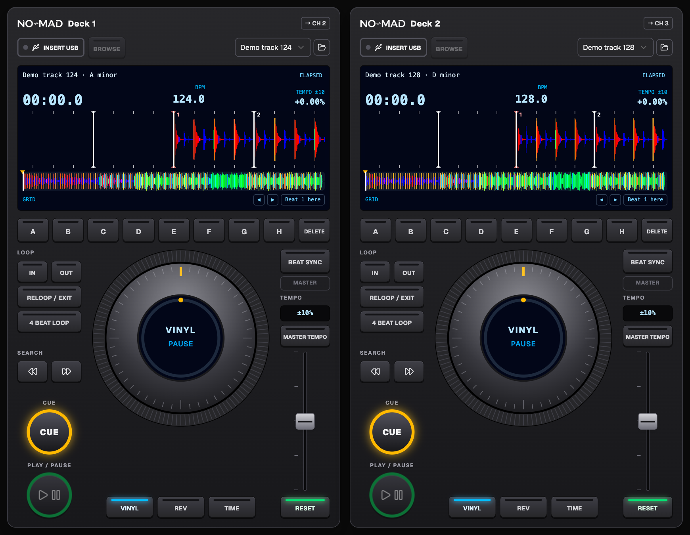
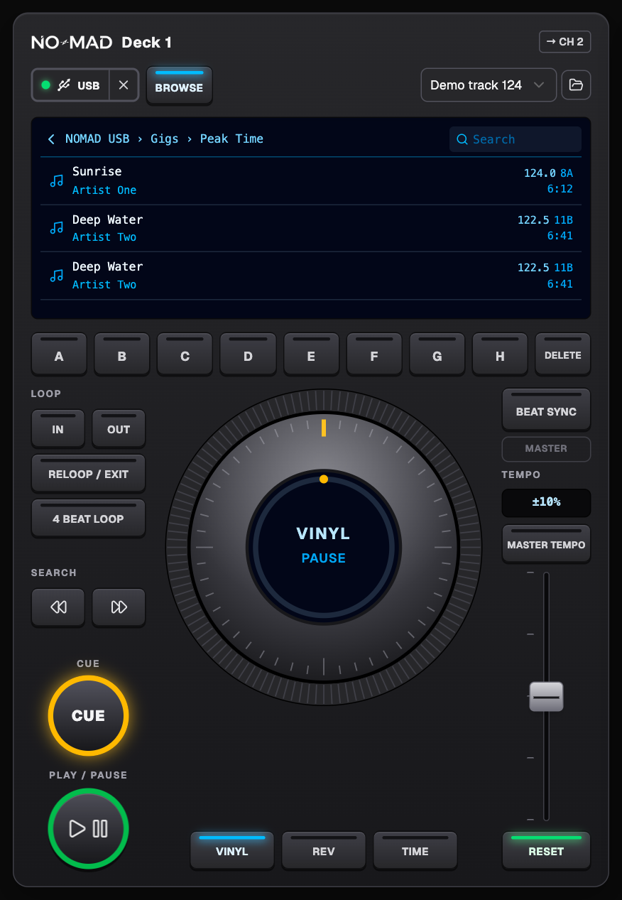
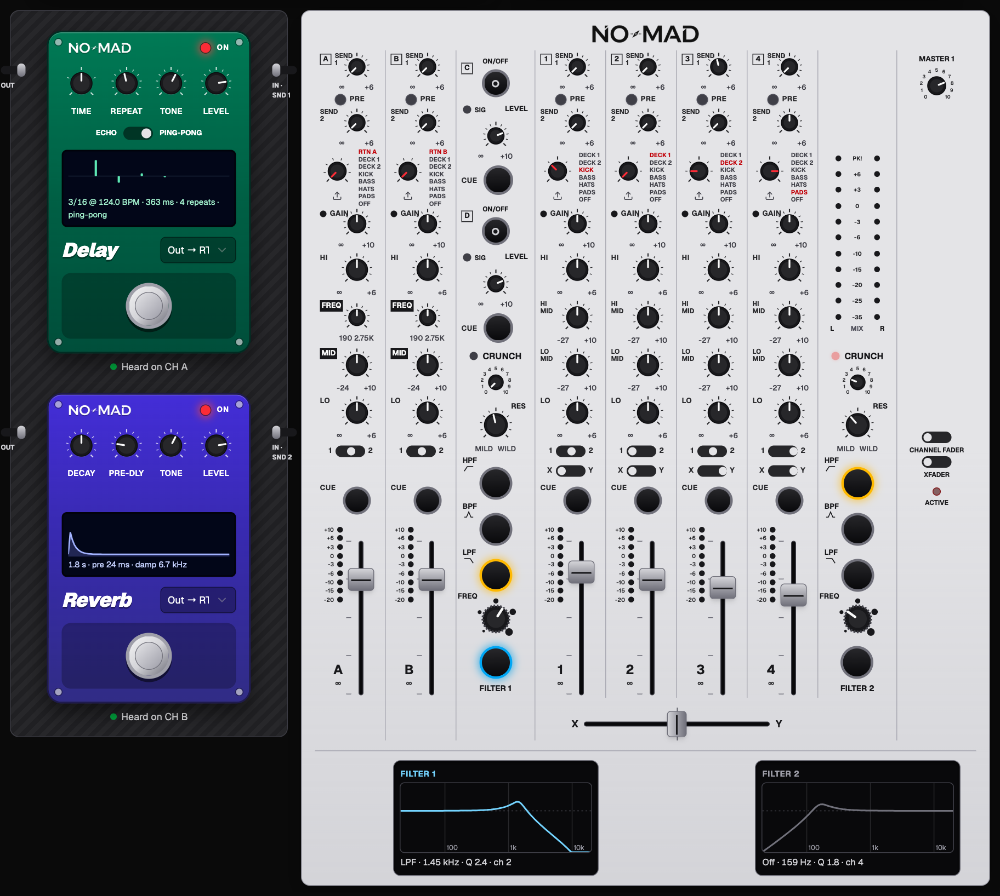

# NO-MAD DJ Setup

**A complete club DJ setup in your browser.** Two CDJ-style players, a 6+2 analogue-style mixer laid out after the Allen & Heath Xone:96, two FX pedals, and a reader for your **rekordbox USB stick**: plug in the stick you'd take to a gig and browse your playlists, beat grids and hot cues, without installing anything.

Built with React, TypeScript, Vite and the Web Audio API. Everything runs locally in the browser; no account, no upload, and your USB is only ever read, never written.

### ▶ [Play it now in your browser](https://nizar2104.github.io/xone96-mixer-emulator/)

No install needed: open the link in **Chrome or Edge** on a computer.

Made by **NO-MAD** · follow on Instagram: [@no.mad.dj_](https://www.instagram.com/no.mad.dj_/)



## What's inside

- **Two CDJ-style decks**: play / cue with real CDJ cue behaviour, VINYL and CDJ jog modes (scratch / pitch bend), needle search, loops (in / out / reloop / 4-beat), **8 hot cues (A–H)**, tempo ±6 / 10 / 16 % and WIDE, **Master Tempo** (key lock), automatic **BPM and beat-grid detection**, **BEAT SYNC** with phase lock and a scrolling RGB waveform.
- **rekordbox USB browser**: reads the stick's `export.pdb` and analysis files. Browse **playlists and folders** just like on a CDJ, or all tracks with search; tracks load with rekordbox's **beat grid, memory cues and hot cues**. The USB is shared by both decks (like Pro DJ Link).
- **6+2 mixer** modelled on the Xone:96 top panel: channels A · 1–4 · B, 4-band / parametric EQ, gain, SEND 1 (pre/post) and SEND 2, returns, two **VCF filters** (HPF / BPF / LPF, resonance, CRUNCH), crossfader and channel-fader curves, metering and cue.
- **FX pedals**: tempo-synced stereo **delay** (SEND 1) and **reverb** (SEND 2), patchable to RTN A–D, with footswitch bypass and trails.
- **MIDI Learn**: map any MIDI controller, with guided step-by-step setups for **Traktor Kontrol Z1 (MK1)** and **X1 MK2**, LED feedback, and mapping export / import.
- **Built-in loops and demo tracks**, so you can try everything without your own music.

## Screenshots

**Two CDJ-style decks** with RGB waveforms, beat grid, 8 hot cues, loops, tempo and Master Tempo:



**Browsing a rekordbox USB** on a deck: folders, playlists and tracks with BPM and key.



**6+2 mixer and FX pedals**: EQ, sends, returns, two VCF filters with live response curves, delay and reverb:



## Step-by-step guide

### 1. Open it

The quickest way: open **[nizar2104.github.io/xone96-mixer-emulator](https://nizar2104.github.io/xone96-mixer-emulator/)** in Chrome or Edge on a computer, and skip to step 2.

#### Or run it on your own computer

Running it locally also works offline. You need [Node.js](https://nodejs.org/) 20.19 or newer and **Google Chrome or Microsoft Edge** (needed for MIDI and for reading a USB folder).

```bash
git clone https://github.com/nizar2104/xone96-mixer-emulator.git
cd xone96-mixer-emulator
npm install
npm run build
npm run preview
```

Open the address it prints (usually **http://localhost:4173**).

> **Play from the build, not the dev server.** `npm run dev` (http://localhost:5173) is for editing the code; its extra work can make deck audio crackle. `npm run build` + `npm run preview` gives clean playback.

### 2. Make some noise

1. Click **Play loops**. The browser only allows sound after a click, so this also switches audio on.
2. Push up the **channel faders** on the mixer and the **master level**. Turn the EQ and filter knobs to hear them work.
3. Each mixer channel has a **source selector** at the top: choose a built-in loop, **Deck 1**, **Deck 2**, a **return**, or load your own audio file onto it.

### 3. Play a track on a deck

1. Each deck starts with a demo track. Pick another from the **track menu**, or click the **folder icon** to load any audio file from your computer.
2. The **→ CH** badge on the deck shows which mixer channel it plays through (by default Deck 1 → CH 2 and Deck 2 → CH 3). Raise that channel's fader.
3. Press **PLAY**. Use **CUE**, the **jog wheel** (in VINYL mode the top scratches and the outer ring bends the pitch; switch to CDJ mode to bend from the top), the **tempo fader** and **SEARCH** buttons like on a CDJ.
4. Press **BEAT SYNC** on the second deck to lock its tempo and phase to the first. **MASTER TEMPO** keeps the key when you change tempo.
5. Hot cues **A–H**: press an empty pad to store the playhead, press it again to jump there. Use **DELETE** then a pad to clear it.
6. Loops: **IN** / **OUT** set a loop, **RELOOP / EXIT** toggles it, **4 BEAT LOOP** makes an instant beat-matched loop.

### 4. Use your rekordbox USB stick

1. In rekordbox, export your playlists to the USB as you normally would for CDJs, then plug the stick into your computer.
2. On a deck, click **Insert USB** and choose the **top folder of the USB drive** (e.g. `KINGSTON`), not the `PIONEER` folder inside it. Chrome asks to confirm read access to the folder.
3. A message confirms how many tracks and playlists were found. The green light next to **USB** shows the stick is in; both decks can use it.
4. Press **BROWSE** on a deck. You'll see **All tracks** and your playlists and folders in rekordbox order:
   - click a folder or playlist to open it, and **‹** to go back up;
   - in a track list, type in **Search** to filter by title, artist, album or key;
   - click a track to load it. It comes in with rekordbox's **beat grid, memory cues and hot cues**.
5. Press **BROWSE** again to close the browser. It reopens where you left it.
6. Click **✕** next to USB to eject.

No rekordbox export on the stick? You still get a list of every audio file on it, and the app detects BPM and beat grid itself.

### 5. Add effects

1. Turn up **SEND 1** on a channel to feed the **delay** pedal, or **SEND 2** for the **reverb**.
2. Set the pedal's knobs (delay: time, repeat, tone, level; reverb: decay, tone, level) and choose which return (**RTN A–D**) it comes back on.
3. Stomp the **footswitch** to bypass the pedal. Echoes and reverb tails ring out naturally.

### 6. Connect a MIDI controller (optional)

1. Connect your controller and put it in **MIDI mode**.
2. Scroll to the **MIDI** panel under the mixer and switch it on. Chrome asks for MIDI permission.
3. For a Traktor Kontrol **Z1** or **X1 MK2**, open **Guided setup** and move each control when asked. For anything else, use **Learn**: click a control in the app, then move the knob or button on your controller.
4. Save your work under **Mappings → Export**, and load it again later with **Import**.

No luck with MIDI in the browser on macOS? `tools/midi-map.swift` does the guided mapping in the Terminal and writes a file you can import (instructions at the top of that file).

## Troubleshooting

| Problem | Fix |
| --- | --- |
| No sound | Click **Play loops** or a deck's PLAY first; check the channel fader, master level and the channel's source selector. |
| Crackles or dropouts | Use `npm run build` + `npm run preview` instead of `npm run dev`, and close heavy browser tabs. |
| USB shows files but no playlists | Pick the drive's **top folder**. The stick needs a rekordbox export (a `PIONEER` or hidden `.PIONEER` folder with `rekordbox/export.pdb`). |
| "Audio file not found on the USB" | You picked a subfolder; choose the drive's top folder so the `Contents` folder is included. |
| A track won't load | The browser can't decode that format; MP3, WAV, AIFF, M4A/AAC and FLAC work in Chrome. |
| MIDI controller not listed | Use Chrome or Edge, put the controller in MIDI mode, then reconnect it and reload the page. |

## For developers

```bash
npm run dev             # dev server with hot reload (http://localhost:5173)
npm run typecheck       # TypeScript
npm run lint            # ESLint
npm run test:rekordbox  # rekordbox reader fixture check (synthetic export.pdb; Node 22.18+)
npm run build           # production build in dist/
```

## Project layout

- `src/lib/mixer-engine.ts` – mixer, filters, sends/returns, delay and reverb
- `src/lib/cdj-deck.ts` – deck player, Master Tempo, demo tracks
- `src/lib/beat-detect.ts` – BPM / beat-grid detection (Mixxx / Queen Mary port, GPL), run in a worker (`analysis-worker.ts`, `analysis-client.ts`) together with the RGB waveform analysis (`waveform.ts`)
- `src/lib/rekordbox.ts` – export.pdb / ANLZ reader
- `src/lib/midi.ts` – MIDI Learn engine and guided setups
- Some files under `src/lib/` and `src/components/` (console capture, connector policy, preview bridges) come from the Microsoft App Builder template the app was first built in; they are inert outside that host and can be removed.

The rekordbox reader is written from the public format analysis by Deep Symmetry
(https://djl-analysis.deepsymmetry.org/rekordbox-export-analysis/).

## Follow

Follow NO-MAD on Instagram: **[@no.mad.dj_](https://www.instagram.com/no.mad.dj_/)**

## License

This app is licensed under the **GNU General Public License, version 2 or later** (see `LICENSE`),
because the BPM / beat-grid detection in `src/lib/beat-detect.ts` is a port of GPL code:

- [Mixxx](https://github.com/mixxxdj/mixxx) – `AnalyzerQueenMaryBeats` and `BeatUtils`
  (constant-tempo grid, BPM rounding, phase adjustment). © Mixxx Development Team, GPL-2.0-or-later.
- [Queen Mary DSP library (qm-dsp)](https://github.com/c4dm/qm-dsp) as bundled with Mixxx –
  `DetectionFunction`, `PhaseVocoder`, `TempoTrackV2`, `DownBeat`, `MathUtilities`.
  © Centre for Digital Music, Queen Mary, University of London (Christian Landone, Matthew Davies,
  Adam Stark, Chris Cannam and others), GPL-2.0-or-later.

The port follows Mixxx's fixed-tempo analysis; on top of it the app adds an on-beat check (so loud
off-beat hats/bass cannot pull the grid half a beat late) and uses qm-dsp's `DownBeat` to place beat 1,
which Mixxx itself does not do.

Not affiliated with or endorsed by Allen & Heath, Pioneer DJ / AlphaTheta or Native Instruments.
"Xone", "CDJ", "rekordbox" and "Traktor" are trademarks of their owners and are used only to describe compatibility and the hardware the layout is modelled on.
